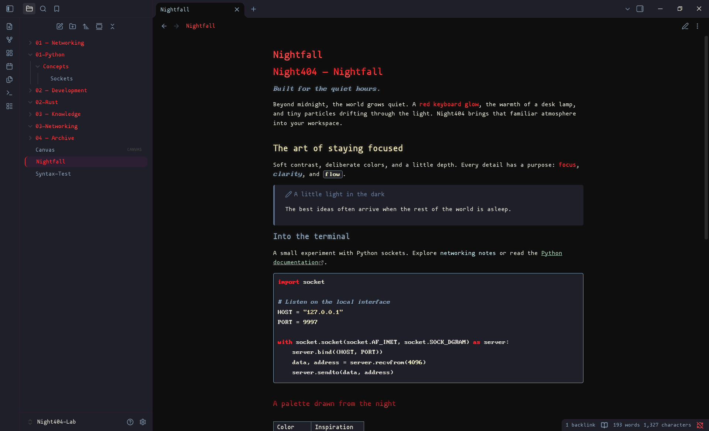

# Night404

**Nightfall Update — 1.1.0**

> Built for the quiet hours.

Night404 is a dark theme for Obsidian inspired by the atmosphere of late-night coding: the red glow of keyboard LEDs, the warm yellow of a desk lamp, and the dusty blue of particles floating in its light. A nearly black background and soft cream text complete a palette drawn from that familiar workspace.

Nightfall extends the original palette with subtle gradients and glow, while keeping the focus on writing, technical notes and code.

## Installation

Night404 is available free of charge in the [Obsidian Community Store](https://community.obsidian.md/themes/night404).

1. Open **Settings → Appearance → Themes → Manage**.
2. Search for **Night404**, install it and select **Use**.
3. Use Obsidian's dark appearance.

For manual installation, download `theme.css` and `manifest.json` from the matching [release](https://github.com/404mon/Night404/releases), place both in `.obsidian/themes/Night404/` inside your vault, and select Night404 under Appearance.

Nightfall targets Obsidian 1.13.4 or newer. Older versions are outside the supported target for this update.

## Nightfall features

- Six distinct heading colors with gradients, subtle glow and multiline styling.
- Semantic gradients for bold, italic and inline code, including formatted headings.
- Vertical gradients for folder names, inactive notes and tabs, active tabs and note titles.
- Improved syntax highlighting, two code block backgrounds and configurable code typography.
- Custom Markdown highlighting, tags, callouts and neon-style Canvas nodes.
- CSS-only styling with no required community plugin or bundled fonts.

## Palette

| Color | Hex | Inspiration |
| --- | --- | --- |
| Deep Night | `#0e0e0e` | A dark room |
| Dark Gray | `#1f1f29` | Workspace surfaces |
| Keyboard LED | `#d3181c` | Red keyboard lighting |
| Focus Red | `#ff252b` | Bright emphasis |
| Desk Lamp | `#f7ecb9` | Warm yellow light |
| Dusty Blue | `#8ea8c1` | Particles caught in light |
| Terminal Cream | `#eae8db` | Soft main text |

## Customization (optional)

Install and enable [Style Settings](https://community.obsidian.md/plugins/obsidian-style-settings), then open its settings and expand **Night404**. The theme works without the plugin; the controls below are optional.

### Code & Syntax

| Setting | Default |
| --- | --- |
| Code block background | Dark Gray (`#1f1f29`); Deep Night (`#0e0e0e`) optional |
| Hide code block borders | Off |
| Disable bold keywords | Off |
| Disable italic comments | Off |
| Code block corner radius | 4 px (0–16 px) |
| Code line height | 1.5 (1.2–2) |

### Typography & Headings

| Setting | Default |
| --- | --- |
| Disable Nightfall gradients | Off |
| Gradient direction | Vertical (horizontal and diagonal optional) |
| Gradient intensity | 30% light-color mix (0–60%) |
| Glow intensity | 15% (0–40%) |
| Glow radius | 5 px (0–12 px) |
| Disable formatted text gradients | Off |

The gradient intensity also affects formatted body text and some interface gradients. Setting it to zero removes the lighter color mix, not the darker stop; use the relevant disable switch to restore solid colors.

### Nightfall Interface

All four disable switches are off by default: folder gradients, inactive note gradients, active tab gradients, and note title gradients. Inactive note gradients cover both the file explorer and inactive tabs. The active file in the explorer retains its solid red accent.

## Typography

The original preview uses **Proto Nerd Font** for the interface and standard text, and **BigBlueTerm Nerd Font Mono** for code. These fonts are optional and are not distributed with the theme. Configure your preferred fonts through Obsidian's Appearance settings.

## Feedback and contributions

Report rendering issues or suggest improvements through [GitHub Issues](https://github.com/404mon/Night404/issues). Include the Obsidian version, platform and editor mode. See [CONTRIBUTING.md](CONTRIBUTING.md) and [CHANGELOG.md](CHANGELOG.md).

## License

[MIT](LICENSE) — 404mon.
