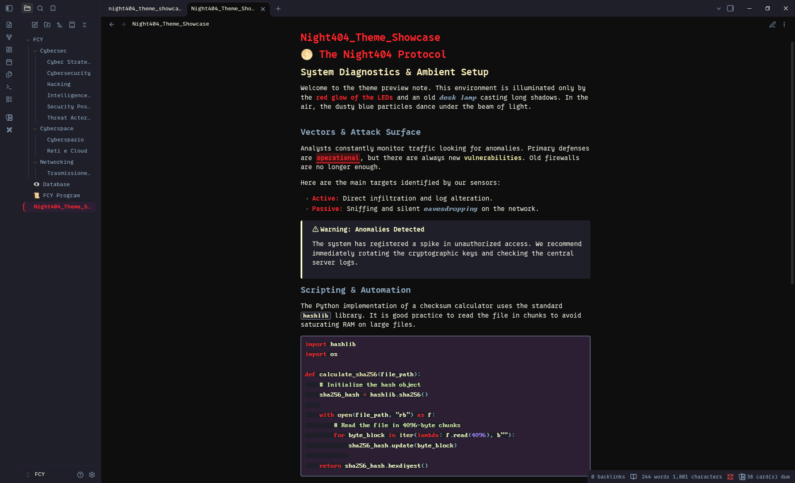

# 🌕 Night404 Theme for Obsidian

> A dark theme inspired by nighttime ambient lighting: the red glow of keyboard LEDs, the warm yellow of a classic desk lamp, and the dusty light blue of floating particles caught in direct light.

## 🎨 The Palette & Inspiration

Night404 is designed to be easy on the eyes while keeping a distinct, atmospheric cyberpunk/hacker vibe. 

| Color | Hex | Inspiration |
| :--- | :--- | :--- |
|  | `#0e0e0e` | **Deep Night** - The pitch-black room |
|  | `#d3181c` | **Keyboard LED** - Striking, glowing red accents |
|  | `#f7ecb9` | **Desk Lamp** - Warm, comforting yellow for highlights |
|  | `#8ea8c1` | **Floating Dust** - The dusty blue of particles in the light |
|  | `#eae8db` | **Terminal Cream** - Soft main text to prevent eye strain |

## 🔤 Typography

To achieve the exact look seen in the screenshots, the following fonts are used:
* **Proto Nerd Font** for the main interface and standard text.
* **BigBlueTerm Nerd Font Mono** for inline code and code blocks.

*Note: You will need to install these fonts on your system or add them via CSS snippets if you want an identical setup.*

## ✨ Features
- Fully compatible with Obsidian's modern UI and Live Preview.
- Custom stylized blockquotes and callouts.
- Neon-style Canvas elements.
- Optimized for monospace coding fonts.

## 🚀 Manual Installation

Until the theme is officially available in the Obsidian community store, you can install it manually:
1. Download `theme.css` and `manifest.json` from this repository.
2. Open your Obsidian vault and go to `.obsidian/themes/`.
3. Create a folder named `Night404` and paste the two files inside.
4. Open Obsidian Settings > Appearance > Themes and select **Night404**.